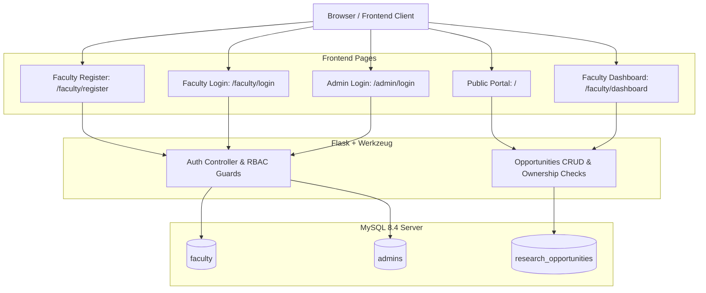

# University Research Opportunity Portal
**Assignment No. 1 — Computer Networks (Fall 2026)**  
**FAST-NUCES, Peshawar Campus**  
*BS Computer Science (BS CS 5B)*

---

## 📖 Overview
The **FAST-NUCES Research Opportunity Portal** is a production-grade web application built to facilitate academic research collaboration between professors and undergraduate students. It features a modern dark-mode interface with glassmorphism aesthetics, dynamic filtering, real-time database health monitoring, and a **Three-Role Access Control (RBAC)** architecture:

1. **Visitors (Public Read-Only)**: Students and external guests can browse, search, and view all published research opportunities without authenticating or providing credentials. Visitors cannot create, edit, or delete any listings.
2. **Faculty Members (Authenticated Self-Service)**: Faculty members register with their university email, log in securely, and manage their own research opportunities through a dedicated personal dashboard. Strict backend ownership authorization ensures faculty can only edit and delete posts they created.
3. **Portal Administrator (Global Management)**: System administrator with full authority to oversee, modify, and delete any research opportunity portal-wide, and post official university listings.

---

## 🏛️ System Architecture



---

## 🗄️ Database Architecture & Schema

### 1. `research_opportunities` Table
Contains the research listings linked to faculty creators:
* `id` (`INT AUTO_INCREMENT PRIMARY KEY`)
* `title` (`VARCHAR(255) NOT NULL`): Research project title
* `description` (`TEXT NOT NULL`): Project summary and objectives
* `research_area` (`VARCHAR(150) NOT NULL`): Research field (e.g., Computer Networks, AI, Photonics)
* `faculty_name` (`VARCHAR(150) NOT NULL`): Lead investigator / professor name
* `department` (`VARCHAR(100) NOT NULL`): Academic department
* `required_skills` (`TEXT NOT NULL`): Technical prerequisites and tools
* `available_positions` (`INT NOT NULL`): Available seats (must be positive integer)
* `deadline` (`DATE NOT NULL`): Application cutoff date (`YYYY-MM-DD`)
* `status` (`ENUM('Open', 'Closed') NOT NULL`): Current status
* `faculty_id` (`INT DEFAULT NULL`, `FOREIGN KEY` references `faculty(id)`): Owner faculty account (`NULL` indicates admin-created post)

### 2. `faculty` Table
Stores registered faculty member accounts:
* `id` (`INT AUTO_INCREMENT PRIMARY KEY`)
* `full_name` (`VARCHAR(150) NOT NULL`): Faculty display name
* `email` (`VARCHAR(200) UNIQUE NOT NULL`): University email address
* `department` (`VARCHAR(100) NOT NULL`): Academic department
* `password_hash` (`VARCHAR(255) NOT NULL`): Cryptographically hashed password using Werkzeug scrypt
* `is_active` (`TINYINT(1) DEFAULT 1`)
* `created_at` (`TIMESTAMP DEFAULT CURRENT_TIMESTAMP`)

### 3. `admins` Table
Stores administrative credentials:
* `id` (`INT AUTO_INCREMENT PRIMARY KEY`)
* `username` (`VARCHAR(100) UNIQUE NOT NULL`)
* `password_hash` (`VARCHAR(255) NOT NULL`)
* `full_name` (`VARCHAR(150)`): Administrator display name
* `created_at` (`TIMESTAMP DEFAULT CURRENT_TIMESTAMP`)

**Default Seeded Admin Credentials:**
* **Username:** `admin`
* **Password:** `AdminPassword123!`

---

## 🚀 Getting Started & Setup Instructions

### 1. Prerequisites
Ensure Python 3.10+ and MySQL are installed:
```bash
python3 --version
sudo systemctl status mysql
```

### 2. Virtual Environment & Dependencies
```bash
python3 -m venv venv
source venv/bin/activate
pip install -r requirements.txt
```

### 3. Environment Configuration
Copy `.env.example` to `.env` if not already present:
```bash
cp .env.example .env
```
Ensure credentials match your MySQL installation:
```env
DB_HOST=localhost
DB_PORT=3306
DB_USER=portal_user
DB_PASSWORD=portal_pass123
DB_NAME=research_portal
PORT=5000
SECRET_KEY=fast_nuces_secure_session_secret_2026
ADMIN_USERNAME=admin
ADMIN_PASSWORD=AdminPassword123!
```

### 4. Run the Portal
Start the backend server:
```bash
source venv/bin/activate
python3 backend/app.py
```
Access the application URLs:
* **Public Visitor Portal**: `http://127.0.0.1:5000/`
* **Faculty Registration**: `http://127.0.0.1:5000/faculty/register`
* **Faculty Login**: `http://127.0.0.1:5000/faculty/login`
* **Faculty Dashboard**: `http://127.0.0.1:5000/faculty/dashboard`
* **Admin Login**: `http://127.0.0.1:5000/admin/login`

---

## 📡 REST API Reference

| Method | Endpoint | Access Level | Description | Status Codes |
| :--- | :--- | :--- | :--- | :--- |
| **`GET`** | `/api/opportunities` | **Public** | Browse all research opportunities | `200 OK`, `500 Error` |
| **`GET`** | `/api/opportunities/:id` | **Public** | View specific opportunity details | `200 OK`, `404 Not Found` |
| **`GET`** | `/api/health` | **Public** | Database health and connectivity | `200 OK`, `500 Error` |
| **`GET`** | `/api/auth/status` | **Public** | Check current session role & identity | `200 OK` |
| **`POST`** | `/api/faculty/register` | **Public** | Register a new faculty account | `201 Created`, `409 Conflict`, `422 Unprocessable` |
| **`POST`** | `/api/faculty/login` | **Public** | Authenticate faculty member | `200 OK`, `400 Bad Request`, `401 Unauthorized` |
| **`POST`** | `/api/faculty/logout` | **Faculty** | Faculty logout and session invalidation | `200 OK` |
| **`GET`** | `/api/faculty/opportunities`| **Faculty/Admin** | Retrieve only opportunities owned by user | `200 OK`, `401 Unauthorized` |
| **`POST`** | `/api/auth/login` | **Public** | Authenticate portal administrator | `200 OK`, `401 Unauthorized` |
| **`POST`** | `/api/auth/logout` | **Admin** | Admin logout and session invalidation | `200 OK` |
| **`POST`** | `/api/opportunities` | **Faculty / Admin**| Create research opportunity (auto-tagged with faculty ID) | `201 Created`, `400 Bad Request`, `401 Unauthorized` |
| **`PUT`** | `/api/opportunities/:id` | **Owner / Admin** | Update opportunity (strict ownership check) | `200 OK`, `403 Forbidden`, `404 Not Found` |
| **`DELETE`**| `/api/opportunities/:id` | **Owner / Admin** | Delete opportunity (strict ownership check) | `200 OK`, `403 Forbidden`, `404 Not Found` |

---

## 🔒 Security & Ownership Isolation Highlights

* **Backend Ownership Enforcement:** Every opportunity posted by a faculty member records their `faculty_id`. When any faculty member attempts to `PUT` or `DELETE` an opportunity, the backend queries the existing record and verifies `opportunity.faculty_id == authenticated_user.id`. If mismatched, the request is rejected immediately with **`403 Forbidden`**. Tampering with the opportunity ID in API requests is strictly blocked.
* **Password Security:** All passwords (faculty and admin) are hashed using cryptographically secure scrypt hashing before storage. Passwords are never stored in plaintext.
* **Duplicate Account Protection:** Faculty registration enforces unique university emails; attempting to register an existing email returns **`409 Conflict`**.
* **Visitor Read-Only Guarantee:** Unauthenticated requests to mutation endpoints (`POST`, `PUT`, `DELETE`) are rejected with **`401 Unauthorized`**.

---

## 🧪 Automated Testing

Execute the comprehensive automated test suite verifying all 18 RBAC scenarios:
```bash
python3 backend/test_rbac.py
```

Test results cover:
1. Visitor read-only access and mutation block (`401 Unauthorized`).
2. Faculty registration validation, duplicate email detection (`409 Conflict`), and password mismatch protection.
3. Faculty authentication, session issuance, and `/api/auth/status`.
4. Faculty post creation and personal dashboard filtering (`GET /api/faculty/opportunities`).
5. **Backend security**: Cross-faculty edit and delete attempts rejected with `403 Forbidden`.
6. Owner faculty self-service edit and delete (`200 OK`).
7. Admin overarching authority to manage any faculty post and create portal-wide posts.
8. Static frontend route availability (`/`, `/faculty/register`, `/faculty/login`, `/faculty/dashboard`, `/admin/login`).

---

## 📦 Submission Packaging
```bash
zip -r P24_0000_NAME_CLASS.zip . -x "venv/*" ".git/*" ".env" "__pycache__/*" "backend/__pycache__/*"
```
Ensure the ZIP includes:
* Backend and frontend source code
* `database/schema.sql`
* `postman/University_Research_Opportunity_Portal.postman_collection.json`
* `README.md` and `PROJECT_STATUS.md`
* Link to demonstration video
